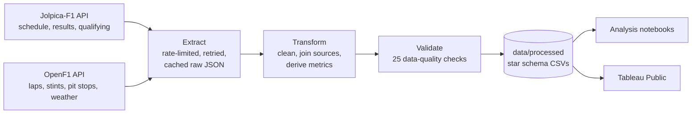
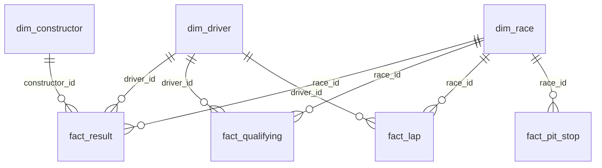

# F1 Data Portfolio

An end-to-end Formula 1 analytics project. A Python pipeline pulls data from two public F1 APIs,
cleans it, models it as a star schema and publishes analysis-ready CSVs. The analysis projects
(race-outcome prediction and tyre strategy) and the Tableau dashboards are all built on those CSVs.

| | |
|---|---|
| **Coverage** | 270 Grands Prix (2014 to Oct 2026); lap-level timing for 88 races (2023+) |
| **Volume** | 97,230 laps, 5,501 race results, 5,480 qualifying results, 3,064 pit stops |
| **Sources** | [Jolpica-F1](https://github.com/jolpica/jolpica-f1) (Ergast successor) · [OpenF1](https://openf1.org) |
| **Stack** | Python, pandas, REST APIs, pytest; Tableau Public for dashboards |

## Projects in this repo

| # | Project | Focus | Status |
|---|---|---|---|
| 1 | [Data pipeline](#project-1-data-pipeline) | ETL, data modelling, data quality | ✅ Done |
| 2 | Race outcome prediction | Classification modelling, feature engineering | 🔜 Next |
| 3 | Tyre strategy & degradation | Statistical analysis, Tableau storytelling | 🔜 Planned |

---

## Project 1: Data pipeline



**What it does**

- **Extract.** Calls two REST APIs with rate limiting, exponential-backoff retries and pagination
  handling. Every response is cached as raw JSON, so runs are resumable and incremental: a re-run
  only downloads new races.
- **Transform.** Joins the two sources, which use different identifiers. Races are matched on
  start time; drivers are matched through the race-specific car number. The step also standardises
  lap times, rebuilds each driver's tyre age lap by lap from stint data, attaches the nearest weather
  reading to every lap, and flags laps behind the safety car or in the pit lane so they can be
  excluded from pace analysis.
- **Validate.** Primary-key uniqueness, null keys, value ranges, referential integrity and coverage
  ratios, plus sanity checks against known race winners. A hard failure stops the run. Each run
  writes [`_quality_report.md`](data/processed/_quality_report.md) and a
  [`_manifest.json`](data/processed/_manifest.json) with row counts and API usage.

### Data model



| Table | Grain | Key columns |
|---|---|---|
| `dim_race` | one row per Grand Prix | season, round, circuit, location, race-day weather (2023+) |
| `dim_driver` | one row per driver | code, name, nationality, date of birth |
| `dim_constructor` | one row per team | name, nationality |
| `fact_result` | driver × race | grid, finish position, points, status, positions gained |
| `fact_qualifying` | driver × race | Q1/Q2/Q3 times, best time, gap to pole % |
| `fact_lap` | driver × race × lap | lap & sector times, speed traps, compound, tyre age, weather, `is_clean_lap` |
| `fact_pit_stop` | driver × race × stop | lap, pit-lane time, stationary time |

All tables share `race_id` (e.g. `2024_01`), `driver_id` and `constructor_id`, so they join directly
in pandas, SQL or Tableau.

### Run it yourself

```bash
pip install -r requirements.txt
PYTHONPATH=src python -m f1pipeline.run                 # results 2014+, lap timing 2023+
PYTHONPATH=src python -m f1pipeline.run --refresh       # pick up races since the last run
PYTHONPATH=src python -m pytest                          # unit tests
```

A first full run makes about 600 API calls and takes about 20 minutes, because it stays inside the
free APIs' rate limits. Later runs read from the cache and finish in seconds.

### Design notes

- **Why not FastF1?** Since October 2026, Formula 1's live-timing feed needs a paid F1 TV
  subscription, and FastF1 now requires signing in. OpenF1 offers the same lap and stint data for
  free, which keeps the project reproducible for anyone.
- **Why CSV rather than a database?** The dataset is about 16 MB, so flat files are the simplest
  thing that works. They version cleanly in Git and load straight into Tableau Public, which can't
  hold a live connection to a cloud warehouse. The star schema would port directly to Snowflake,
  BigQuery or Redshift.
- **Clean-lap rule.** A lap counts as representative when it is not lap 1, not a pit in-lap or
  out-lap, and within 107% of the race's median lap time. That removes safety-car and VSC laps
  without needing race-control data.

---

## Author

**Ankit Raithatha** · Data Analytics & Business Intelligence
