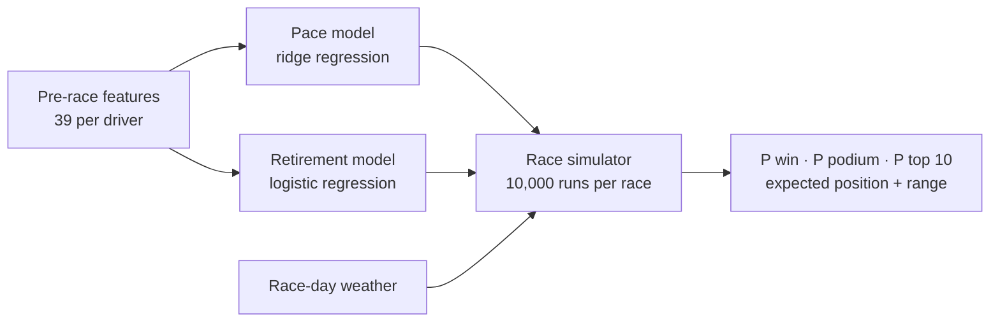
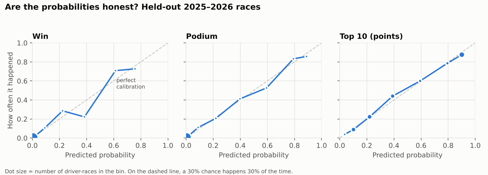
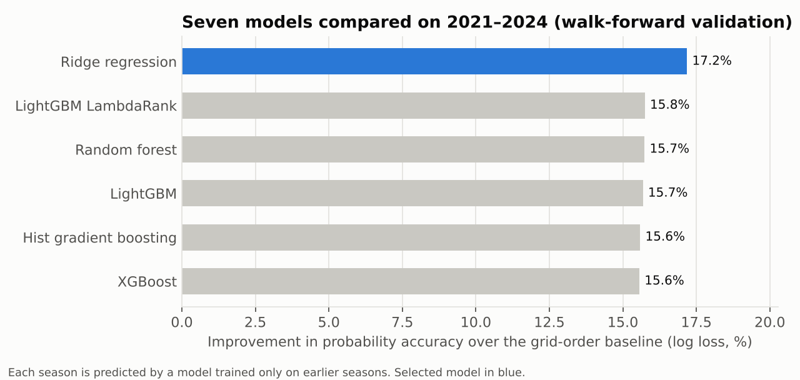
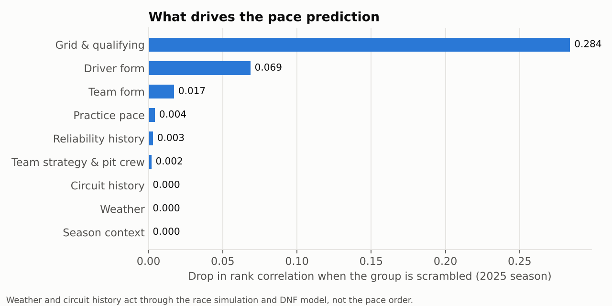
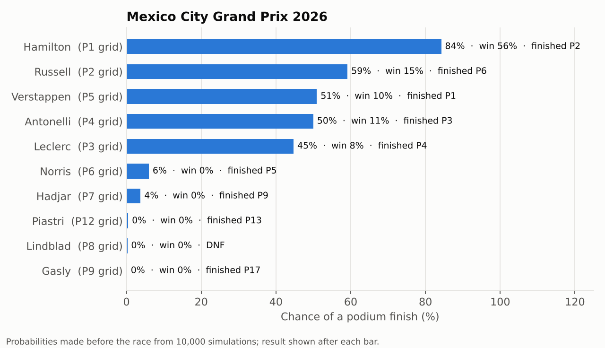

# Project 2: Race outcome prediction

Predicts every driver's chances in a Grand Prix before lights out: **win, podium, points finish
and expected finishing position**. The prediction draws on qualifying, practice pace, driver and
team form, team strategy history, reliability, circuit history and race-day weather.

Races are noisy: cars break down, drivers collide, rain arrives mid-race. So the model doesn't
output one confident finishing order. It estimates how likely each car is to retire, adds
calibrated race-day randomness, and simulates each race **10,000 times**.

### Results on held-out races (2025–2026, 43 Grands Prix)

| | This model | Baseline: grid order |
|---|---|---|
| Probability accuracy (log loss, lower is better) | **0.247** | 0.296 |
| Finishing-order accuracy (rank correlation) | **0.818** | 0.778 |
| Podium picks correct | **73%** | 69% |
| Race favourite finished on the podium | **88%** | — |
| Race favourite won | 63% | 67% (pole-sitter) |
| Retirement rate, predicted vs actual | 13.5% vs 14.7% | — |

- **Probabilities:** 16% more accurate than the baseline (95% bootstrap interval 10% to 24%), and better in 81% of races.
- **Finishing order:** +0.039 rank correlation (95% interval +0.015 to +0.067).
- **Picking the winner:** about level with "back the pole-sitter" (27 vs 29 wins out of 43). More on this under [Limitations](#limitations).

The baseline is the standard comparison in F1 analytics: the cars finish in grid order, with the
same simulation and an average retirement rate.

---

## How it works



**Stage 1. Pace model: "if nothing goes wrong, what's the order?"**
It's trained only on cars that reached the chequered flag, ranked among themselves. Retirements
are deliberately left out of this stage, because whether a car breaks down is a different question
from how fast it is.

**Stage 2. Accounting for what nobody controls**

| Uncontrollable factor | How it's handled |
|---|---|
| Mechanical failures, crashes, first-lap pile-ups | A **retirement model** estimates each car's chance of not finishing from team reliability (last 10 races), driver incident rate (last 20 starts), how often the circuit claims cars, grid position (the midfield is where first-lap contact happens) and rain. |
| Safety cars, strategy gambles, slow pit stops | **Race-day randomness**: each car's pace is perturbed in every simulation. The size of that randomness isn't guessed; it's fitted so the simulated probabilities best match what actually happened in 2021–2024. |
| Rain | The fitted randomness is **1.5× larger in wet races**, a multiplier also fitted on 2021–2024. |

Each race is then simulated 10,000 times. A driver's win probability is the share of simulations
they win, and the same goes for podium and top 10.

**Does accounting for chaos actually help?** Yes, measurably. Removing the retirement model makes
the probabilities worse in 84% of test races (log loss 0.258 vs 0.247; the bootstrap interval
excludes zero). And the probabilities are honest: when the model says 40%, it happens close to 40% of the time.



---

## Data and features

All features use only information available **before the race starts**. Rolling statistics only
look at earlier races. A [leakage test](../../tests/test_features.py) rebuilds every feature with
all future races deleted and checks that nothing changes. That test caught a real leak during
development: a "season progress" feature quietly used the number of races remaining. It was removed.

| Group | Features | Source |
|---|---|---|
| Grid & qualifying | grid slot (incl. penalties), pole / front row, gap to pole %, gap to team-mate %, reached Q3 | Jolpica-F1 |
| Practice pace (2023+) | best-lap gap %, long-run pace gap % (race-sim stints), laps completed | OpenF1 |
| Driver form | avg finish (last 5), points (last 5), positions gained (last 10), experience, history at this circuit, championship position, wet-race racecraft | Jolpica-F1 |
| Team form | avg finish (last 5), season points, constructors' position | Jolpica-F1 |
| Team strategy | pit-crew speed vs field (last 10 races), stops per race vs field, positions gained in races | Jolpica-F1 pit stops |
| Reliability | driver DNF rate (last 20), team DNF rate (last 10) | Jolpica-F1 |
| Circuit history | DNF rate at this track, how strongly grid order holds here, editions held | Jolpica-F1 |
| Weather | air temperature, rain, humidity, wind over the race window | Open-Meteo (ERA5) |
| Context | new-regulation season (2014/2017/2022/2026), round | — |

Team history follows teams through rebrands (Toro Rosso → AlphaTauri → RB, Force India → Racing
Point → Aston Martin, Sauber → Alfa Romeo → Audi, and so on).

---

## Model comparison

Seven approaches were tuned and compared using **walk-forward validation** on 2021–2024: each
season is predicted by a model trained only on the seasons before it. All choices (hyperparameters,
which model, which retirement model, the size of the randomness) were made on these seasons. The
2025–2026 test seasons were held back for the final evaluation.



| Model | Order accuracy (rank corr.) | Probability accuracy (log loss) | Favourite won |
|---|---|---|---|
| **Ridge regression** (log-rank target) | **0.830** | **0.254** | **59%** |
| LightGBM LambdaRank (learning to rank) | 0.820 | 0.259 | 54% |
| Random forest | 0.824 | 0.259 | 57% |
| LightGBM | 0.821 | 0.259 | 58% |
| Histogram gradient boosting | 0.822 | 0.259 | 57% |
| XGBoost | 0.821 | 0.259 | 58% |
| Grid order (baseline) | 0.757 | 0.307 | 51% (pole-sitter) |

**Why the simplest model won.** With about 200 races of training data, the signal is mostly a few
strong, close-to-linear relationships: grid position, gap to pole, recent form. A regularised
linear model captures those without overfitting, while the tree ensembles spend capacity on noise.
Training on the *log* of finishing position was the other key choice. It makes the difference
between P1 and P2 count for more than P15 vs P16, which matches how the front of an F1 grid actually behaves.

For retirements, a logistic regression trained on the **last four seasons only** beat the same
model trained on every season, because cars are far more reliable now than in 2015–2017. It also
beat LightGBM and a constant base rate.

---

## What drives the prediction



- **Qualifying is king.** Scrambling grid and qualifying features costs 0.28 of rank correlation; nothing else comes close.
- **Form is the second signal.** Driver form, then team form, are what let the model beat the grid order.
- **Practice adds almost nothing on top of qualifying** (+0.002 rank correlation on the test seasons). Long-run pace is mostly already reflected in where a car qualifies.
- **Weather and circuit history matter for chaos, not pace.** They don't change who is fastest, but they do change how unpredictable the race is: rain multiplies race-day randomness by 1.5×, and high-attrition circuits raise retirement risk.



---

## Limitations

- **Picking the winner is hard to improve on.** In 2025–2026 the pole-sitter won 67% of races, and the model's favourite won 63%: two races apart in 43. That gap is well within noise (±7 points). In 2021–2024 the model's favourite did better than the pole-sitter (59% vs 51%). The model's advantage is in everything else: the rest of the order, the podium and honest probabilities.
- **Weather is the observed race-day weather** (ERA5 reanalysis), standing in for a forecast. A live version would use a forecast, which is less certain. ERA5 agrees with the circuit's own rain sensor on 90% of races.
- **Retirement causes aren't distinguishable after 2024.** The source now records most retirements as "Retired", so crashes and mechanical failures are modelled together.
- **The test seasons were looked at once before the design was final.** A first run showed the model underrated pole position, which led to adding pole and front-row features and the log-rank target. Both were kept only because they improved the *validation* seasons.
- **New regulations reset form.** 2026 is a new-rules season, so the first races lean on stale team form. Even so, accuracy in 2026 (rank corr. 0.844) was higher than in 2025 (0.797).

---

## Reproduce

```bash
pip install -r requirements.txt
PYTHONPATH=src python -m f1pipeline.run      # data (Project 1), about 35 min first time, seconds after
PYTHONPATH=src python -m f1model.run         # features, model comparison, test evaluation (~6 min)
PYTHONPATH=src python -m f1model.figures     # charts in this README
PYTHONPATH=src python -m pytest              # unit + leakage tests
```

| Output | What it contains |
|---|---|
| [`results/summary.json`](results/summary.json) | every headline number, bootstrap intervals, per-season breakdown |
| [`results/model_comparison_validation.csv`](results/model_comparison_validation.csv) | the model leaderboard |
| [`results/test_predictions.csv`](results/test_predictions.csv) | per-driver probabilities for all 43 test races |
| [`results/calibration_test.csv`](results/calibration_test.csv) | predicted vs observed, by probability bin |
| [`results/ablation_validation.csv`](results/ablation_validation.csv) | accuracy with each feature group removed |

Code: [`src/f1model/`](../../src/f1model): `features.py` (pre-race features), `models.py` (pace models
and walk-forward validation), `chaos.py` (retirement model and race simulator), `run.py`
(selection and evaluation), `figures.py`.
